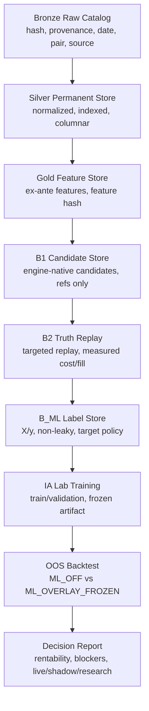

# V5.3 - Audit Run 2420 Et Workflow Institutionnel Cible
Correction importante: ce n’est pas un run 1 jour. Le manifest indique 2025-07-20 -> 2025-07-22, donc 3 jours, timeframe 15m.
Durée réelle par phase:
* A2 Data Factory: ~10m52s.
* B1 Candidate Discovery: ~31m08s.
* B_ML Label Factory: ~8s.
* Total workflow: ~46m.
Le problème de performance principal est donc B1, pas A2.
Qualité Fichiers
A2 est propre en research:
* DATA_FACTORY_READY
* SILVER_INDEX_READY
* FEATURE_STORE_READY
* trades/orderbook/klines couverts sur la fenêtre
* silver compressé jsonl_gz
* rows_rejected=0
* 288 gold rows = 96 bougies/jour x 3 jours en 15m
Mais pas prod-safe:
* RAW_SOURCE_TYPE_INFERRED
* CURRENT_METADATA_PROXY
* SINGLE_PAIR_RESEARCH_ONLY
* prod_safety_status=RESEARCH_ONLY_NOT_PROD_SAFE
Point à corriger dans le reporting: OHLCV_TEMPORAL_COMPLETENESS_NOT_PROVEN, alors que le 15m a bien 96 rows/jour. Le validateur critique semble surtout configuré pour 1m/10m, pas 15m.
Qualité Résultats
B1:
* candidate_count=200
* detailed_replay_count=0
* blockers: EXPECTED_EDGE_PROXY_NOT_BACKTEST_TRUTH, EXPECTED_EDGE_PROXY_BLOCKED, PARTIALLY_MEASURED, STATISTICAL_VALIDATION_INSUFFICIENT_EXECUTIONS
* verdict: pas de preuve rentabilité.
B_ML:
* candidate_count=288
* row_count=3456
* training_row_eligible_count=0
* training_row_research_only_count=1520
* training_row_blocked_count=1936
* feature_leakage_count=0
* target_policy_mismatch_count=0
* verdict: B_ML_DATASET_RESEARCH_ONLY_COST_PARTIAL
Donc le dataset est utile pour audit/research, mais pas encore pour entraîner/promouvoir un ML expected-edge fiable. Cause principale: coût/fill labels partiels/proxy et post-windows manquantes sur 1172 rows.
Pourquoi C’est Lent
B1 profile:
* total_wall_time_s=1865s
* raw_window_extraction=924s
* jsonl_parsing=921s
* seulement 15 fichiers scannés, mais 2.5M rows parsées
Donc B1 relit/parcourt trop de JSONL/raw windows pour matérialiser des fenêtres candidat. Pour 6 mois, cette architecture ne passera pas.
Workflow Institutionnel Cible
1. Bronze immutable
Raw files hashés, catalogués par pair/date/source/type. Aucun backtest ne rescane L: directement.
2. Silver permanent
Normalisation une seule fois par mois/pair/source vers un cache versionné. Sortie préférée: columnar/Parquet ou Arrow, JSONL seulement pour audit.
3. Gold feature store permanent
Features ex-ante précomputées par pair/timeframe: OHLCV, spread/depth, VPIN, OFI, realized vol, queue pressure. Chaque row a timestamp, provenance, feature hash.
4. Candidate store
B1 lit uniquement Gold et écrit candidate_id + refs, pas les raw windows. Matérialisation raw interdite en B1 sauf debug.
5. Label store B_ML
B_ML lit Gold + post-window refs, produit X/y avec eligibility. Labels execution-aware seulement si spread/slippage/fill/adverse selection mesurés.
6. ML training IA Lab
Train uniquement sur label store gelé. Artifact gelé avec feature list, target policy, dataset hash, train/validation dates. Aucun training silencieux dans Backtest.
7. OOS Backtest
Backtest consomme artifact ML frozen + candidate universe frozen. Compare ML_OFF vs ML_OVERLAY_FROZEN sur les mêmes candidats.
8. B2 truth replay
B2 ne matérialise raw windows que pour candidats sélectionnés ou pack d’audit. Pas pour tous les candidats de découverte.
9. Decision report
Ranking timeframe/pair/engine/bucket, ML delta, cost/fill, threshold near-miss, blockers. Profitability seulement si zéro proxy et assez d’exécutions.
Split 6 Mois Recommandé
Pour 6 mois:
* Train: 3 mois
* Validation: 1 mois
* OOS backtest: 2 mois
Puis walk-forward:
* train 90 jours
* validation 30 jours
* test 30 jours
* roll de 30 jours
* embargo/purge entre fenêtres
Patch Prioritaire
Prochaine tranche technique: B1 refs_only par défaut.
Objectif: B1 ne parse plus 2.5M rows et ne fait plus raw_window_extraction pour 200 candidats. Il doit produire seulement les candidats + références vers Silver/Gold. B2/B_ML feront l’extraction ciblée ensuite. Sans ce changement, 6 mois de backtest/training seront trop lents et trop coûteux.

Date: 2026-05-26  
Run audite: `L:\output backtest\runs\strategy_ladder_workflow-2420f971918b13c8`  
Scope: A1 -> A2 -> B1 -> B_ML, `BTCUSDT`, `2025-07-20` -> `2025-07-22`, timeframe `15m`  
Mode: `ML_MODE_OFF`, `TEMPORAL_STRATIFIED`, `preselected_only=true`

## 1. Verdict Executif

Le run est techniquement exploitable pour audit, mais il ne peut pas repondre a la question "V5.3 est rentable ou non".

Verdict courant:

- `BACKTEST_DECISION_REPORT_PARTIAL`
- `profitability_backtest_ready=false`
- `profitability_claim_allowed=false`
- `executed_trade_count=0`
- `research_only=true`
- `live_ready=false`
- `shadow_ready=false`

Les artifacts A2 sont globalement propres pour une fenetre de recherche. Le probleme principal n'est plus "les features ne se calculent pas". Le probleme est que les features calculees ne constituent pas encore une verite economique gouvernee pour expected-edge, couts, fill realism et validation statistique.

## 2. Blockers A Ajouter Au Dernier Audit

Blockers actifs du run B1:

- `EXPECTED_EDGE_PROXY_NOT_BACKTEST_TRUTH`
- `EXPECTED_EDGE_PROXY_BLOCKED`
- `PARTIALLY_MEASURED`
- `STATISTICAL_VALIDATION_INSUFFICIENT_EXECUTIONS`

Le verdict profitability ajoute aussi:

- `EXPECTED_EDGE_PROXY_COUNT_NONZERO`
- `EXECUTION_LABEL_SOURCE_PROXY`
- `FEE_MODEL_PROXY`
- `SPREAD_MODEL_PROXY`
- `SLIPPAGE_MODEL_PROXY`
- `PARTIAL_FILL_PROXY`
- `ADVERSE_SELECTION_PROXY`
- `EVIDENCE_AUDIT_NOT_CONFIRMED`

Interpretation: ce sont des blockers de preuve, pas uniquement des blockers de calcul de features.

## 3. Qualite Des Fichiers A2

A2 Data Factory:

- `data_factory_status=DATA_FACTORY_READY`
- `raw_source_status=RAW_SOURCE_READY`
- `silver_index_status=SILVER_INDEX_READY`
- `gold_feature_store_status=FEATURE_STORE_READY`
- `rows_rejected=0`
- `files_processed=13`
- `files_skipped=6327`
- `rows_processed=3798481`
- `bytes_read=1570492718`
- `bytes_written=244938435`

Gold feature store:

- `feature_row_count=288`
- `gold_timeframes_generated=["15m"]`
- `timeframe_feature_row_count.15m=288`
- `gold_context_row_count=4`
- `gold_context_rows_suppressed_count=4`
- `microstructure_cache_used=true`
- `microstructure_streaming_requested_row_count=288`
- `microstructure_streaming_overlay_row_count=285`
- `microstructure_streaming_missing_row_count=3`
- `blocker_codes=[]` dans le `gold_feature_manifest`

Les 288 rows correspondent a 3 jours de 15m: 96 rows/jour x 3 jours. A2 a donc bien materialise la fenetre demandee pour le timeframe `15m`.

Blockers A2 restants:

- `RAW_SOURCE_TYPE_INFERRED`: source detectee par inference, pas encore preuve typage institutionnelle totale.
- `CURRENT_METADATA_PROXY`: metadata actuelle utilisee comme proxy temporel, drift de 286.871 jours.
- `SINGLE_PAIR_RESEARCH_ONLY`: run single-pair, non generalisable production.
- `OHLCV_TEMPORAL_COMPLETENESS_NOT_PROVEN`: statut reporting conservateur; le count 15m est coherent, mais la preuve formelle reste a clarifier dans le rapport.

## 4. Qualite Des Resultats B1

B1 Candidate Discovery:

- `candidate_discovery_status=CANDIDATE_DISCOVERY_ENGINE_NATIVE_READY`
- `candidate_export_status=CANDIDATE_EXPORT_READY`
- `candidate_count=200`
- `unique_candidate_count=200`
- `engine_native_preselected_count=98`
- `preselection_hard_rejected_count=102`
- `b2_replay_candidate_count=98`
- `trade_eligible_candidate_count=0`
- `replay_record_count=0`
- `evaluation_record_count=0`
- `promotion_record_count=0`
- `capital_bucket_record_count=0`
- `executed_trade_count=0`

Ce que cela veut dire:

- Les moteurs natifs ont bien produit des candidats.
- Le systeme a bien exporte et audite les candidats.
- Aucun candidat n'a franchi le chemin complet jusqu'a une execution backtest truth.
- Les matrices promotionnelles restent vides car il n'y a aucun trade execute.

Le run reste donc un audit de decision et de blocage, pas un backtest de rentabilite.

## 5. Pourquoi Les Blockers Restent Malgre Le Calcul Des Features

### 5.1 Les features ne sont pas l'expected edge

A2 calcule des variables ex-ante comme:

- `close_return`
- `high_low_range`
- `volume`
- `spread_bps`
- `slippage_bps`
- `book_depth_levels`
- `vpin`
- `cumulative_ofi`
- `realized_vol_current`

Ces features decrivent l'etat du marche avant decision. Elles ne prouvent pas, seules, que le trade a un edge attendu gouverne.

Pour debloquer `EXPECTED_EDGE_PROXY_BLOCKED`, il faut un artifact expected-edge gele qui vient d'un training OOS valide:

- dataset X/y non-leaky;
- target policy coherente;
- train/validation/backtest sans overlap;
- labels post-decision exploitables;
- artifact hash et feature hash figes;
- inference attachee au backtest en `ML_MODE_OVERLAY_FROZEN` ou rail gouverne equivalent.

Dans ce run:

- `expected_edge_model_status=EXPECTED_EDGE_MODEL_NOT_REQUESTED`
- `expected_edge_model_artifact_hash=null`
- `expected_edge_governed_count=0`
- `expected_edge_proxy_count=200`
- `expected_edge_label_source=PROXY_FORWARD_RETURN_MEDIAN_TO_CALIBRATE`
- `expected_edge_label_fidelity=EXPECTED_EDGE_PROXY_DISCOVERY_ONLY`

Donc le systeme a des features, mais pas encore de modele expected-edge gouverne branche sur ce run.

### 5.2 Le cout calcule n'est pas encore une verite d'execution

Le summary B1 dit:

- `economic_constants_provenance=PARTIALLY_MEASURED`
- `execution_label_source=REPLAY_PROXY_EXECUTION`
- `fee_model_source=REPLAY_PROXY`
- `spread_model_source=REPLAY_PROXY`
- `slippage_model_source=REPLAY_PROXY`
- `partial_fill_model_source=REPLAY_PROXY`
- `adverse_selection_source=REPLAY_PROXY`

Donc certaines features de cout peuvent exister en A2, mais la chaine B1/B2 ne les certifie pas encore comme labels d'execution promotion-ready. Pour enlever `PARTIALLY_MEASURED`, il faut que le replay prouve:

- spread mesure au timestamp decisionnel;
- slippage mesure via book walk depth20;
- fees prouvees par metadata temporelle ou config de fee auditee;
- fill ratio et partial fill calcules depuis profondeur reelle;
- adverse selection post-entry mesuree;
- provenance reliee a `candidate_id`, pair, timeframe, engine et capital bucket.

Tant que le cout/fill/adverse selection reste proxy ou partiel, le systeme bloque correctement la promotion.

### 5.3 Zero execution bloque la validation statistique

Le run a:

- `executed_trade_count=0`
- `statistical_validation_observation_count=0`
- `statistical_validation_effective_sample_size=0.0`
- `statistical_validation_psr=null`
- `statistical_validation_dsr=null`

Avec zero trade execute, il est impossible de calculer un diagnostic robuste de profitabilite. Le seuil projet reste:

- `<50` trades: inconclusive;
- `50-99` trades: diagnostic fragile;
- `>=100` trades + zero proxy: verdict exploitable.

Ici, le blocker `STATISTICAL_VALIDATION_INSUFFICIENT_EXECUTIONS` est donc correct.

## 6. Pourquoi B_ML Reste Bloque Ou Research-Only

B_ML Label Factory:

- `candidate_count=288`
- `row_count=3456`
- `training_row_eligible_count=0`
- `training_row_research_only_count=1520`
- `training_row_blocked_count=1936`
- `feature_leakage_count=0`
- `target_policy_mismatch_count=0`
- `missing_post_window_count=1172`
- `missing_book_count=24`
- `cost_aware_label_count=0`
- `execution_aware_partial_label_count=0`
- `proxy_label_count=2260`
- `feature_truth_boundary_status_counts.FEATURE_EX_ANTE_AVAILABLE_AT_DECISION=3456`
- `cost_feature_truth_status_counts.A2_COST_FEATURES_RESEARCH_ONLY_NOT_REPLAY_TRUTH=3456`
- `train_eval_overlap_status=MISSING_MANIFEST_WARNING`
- `final_verdict=B_ML_DATASET_RESEARCH_ONLY_COST_PARTIAL`

Point important: B_ML confirme que les features X sont ex-ante et non-leaky. C'est positif.

Mais B_ML ne peut pas encore produire un dataset training/promotion-ready parce que:

- aucun row n'est `TRAINING_ROW_ELIGIBLE`;
- les couts sont marques `A2_COST_FEATURES_RESEARCH_ONLY_NOT_REPLAY_TRUTH`;
- il y a 2260 labels proxy;
- il y a 1172 post-windows manquantes;
- il y a 24 windows book manquantes;
- aucun label n'est cost-aware;
- aucun label n'est execution-aware partial;
- le manifest train/eval est absent ou incomplet pour prouver la separation OOS.

Donc les memes familles de blockers persistent:

- expected edge reste proxy parce que B_ML n'a pas encore produit un artifact ML gouverne utilisable par le backtest;
- partial measurement reste vrai parce que cout/fill/adverse selection ne sont pas encore replay-grounded;
- statistical validation reste insuffisante parce qu'aucun trade execute n'existe.

## 7. Performance Du Run

Le run a dure environ 46 minutes, dont:

- A2: environ 10m52s
- B1: environ 31m08s
- B_ML: environ 8s

Bottleneck B1:

- `total_wall_time_s=1865.855620`
- `rows_processed=2516080`
- `files_scanned=15`
- `raw_window_extraction=924.241s`
- `jsonl_parsing=921.458s`
- `label_store_generation=2.371s`
- `silver_index_lookup=0.224s`
- `parquet_fast_path_status=PARQUET_REPLAY_NOT_PROVEN`

Diagnostic: le probleme de vitesse n'est pas le lookup indexe. Le probleme est que B1 parse et extrait encore de gros raw windows JSONL pendant la discovery. Pour 6 mois, cette architecture ne passera pas.

## 8. Faisabilite Acceleration CPU/RAM

Oui, il est possible d'accelerer fortement le backtest avec les 4 coeurs CPU et une partie importante de la RAM disponible. Mais sur B1, le premier gain propre n'est pas de paralleliser l'ancien chemin: il faut d'abord supprimer le travail inutile.

Constat run 2420:

- `total_wall_time_s=1865.855620`
- `total_cpu_time_s=1625.890625`
- CPU utilise ~= `87.1%` d'un seul coeur
- machine exposee par l'environnement: `NUMBER_OF_PROCESSORS=4`
- utilisation theorique moyenne sur 4 coeurs ~= `21.8%`
- `replay_workers_used=0`
- `replay_cpu_utilization=null`
- hotspots: `raw_window_extraction=924.241s`, `jsonl_parsing=921.458s`

Donc le rail actuel n'exploite pas les 4 coeurs. Il travaille surtout en serie sur extraction/parsing JSONL.

Plan d'acceleration correct:

- B1 doit devenir `refs-only`: lire Gold, produire candidats + refs, ne pas extraire les raw windows.
- A2 peut utiliser les 4 coeurs par pair/source/jour/timeframe.
- B2 peut utiliser les 4 coeurs par candidat ou capital bucket.
- B_ML peut utiliser les 4 coeurs par candidat/post-window.
- La RAM doit servir a des caches bornes, indexes temporels, Arrow/Parquet memory mapping et prefetch, pas a charger 6 mois de raw en objets Python.

Politique RAM recommandee:

- cap par defaut: `60-70%` de la RAM disponible;
- cap operateur optionnel: jusqu'a `80%`, uniquement avec confirmation et mesure;
- spill-to-disk obligatoire si cap atteint;
- metrics obligatoires: `rss_mb`, `peak_rss_mb`, `worker_count`, `cpu_percent`, `cache_hit_rate`, `spill_count`.

Ce qu'il ne faut pas faire:

- lancer 4 workers qui reparsent les memes JSONL;
- charger toutes les raw windows B1 en RAM;
- viser `80%` RAM sans garde-fou;
- paralleliser B1 avant d'avoir separe discovery et replay truth.

Conclusion: objectif valide, mais ordre correct = `B1 refs-only` d'abord, puis parallelisation A2/B2/B_ML, puis cache RAM borne et mesure.

## 9. Workflow Institutionnel Cible

Objectif: separer les couches "donnees", "features", "candidats", "labels", "training ML", "backtest OOS" et "decision report", avec des artifacts figes et auditables.

### Couche 1 - Bronze Catalog

But: scanner les raw une fois, pas a chaque run.

Sorties:

- `raw_catalog.parquet` ou equivalent;
- hash par fichier;
- pair/source/date/timeframe;
- source type prouvee;
- metadata temporelle rattachee.

Critere de sortie: le cockpit ne pointe plus directement un backtest 6 mois vers `L:\klines`, `L:\trades`, `L:\ordrebookpart1` sans catalogue.

### Couche 2 - Silver Permanent Store

But: normaliser et indexer durablement par mois/pair/source.

Sorties:

- silver trade/orderbook/kline compresse;
- index temporel par pair/source/day;
- format cible columnar pour les gros scans, idealement Parquet/Arrow;
- rapports de gaps et schema.

Critere de sortie: A2 peut reexecuter un mois deja traite sans reparsing complet des raw.

### Couche 3 - Gold Feature Store

But: produire les features ex-ante une seule fois par feature set/timeframe.

Sorties:

- feature rows par pair/timeframe/timestamp;
- `feature_hash`;
- provenance A2;
- coverage report;
- microstructure status par feature.

Critere de sortie: B1 lit Gold seulement pour decouvrir des candidats.

### Couche 4 - B1 Candidate Store Refs-Only

But: discovery rapide, sans materialiser les raw windows.

Sorties:

- candidates engine-native;
- `candidate_id`;
- pair/timeframe/engine/timestamp;
- refs vers Gold/Silver;
- reason codes;
- no-trade diagnosis.

Patch prioritaire: B1 doit passer en mode refs-only par defaut. Les raw windows ne doivent etre extraits qu'en B2/B_ML cible.

### Couche 5 - B2 Truth Replay

But: verifier uniquement les candidats utiles avec execution realism.

Sorties:

- replay records;
- by-bucket records;
- spread/slippage/fees/fill/adverse selection mesures;
- capital bucket truth;
- blockers restants.

Critere de sortie: `PARTIALLY_MEASURED` disparait seulement quand cout/fill/adverse selection sont mesures et prouves.

### Couche 6 - B_ML Label Store

But: produire X/y scientifique, pas forcer des trades.

Sorties:

- X ex-ante;
- y post-decision;
- row eligibility;
- target policy consistency;
- leakage report;
- train/eval window report.

Critere de sortie: `training_row_eligible_count > 0`, `proxy_label_count=0` pour le target promotion, cost/fill truth disponible.

### Couche 7 - IA Lab Training

But: entrainer hors backtest, sur dataset gele.

Sorties:

- frozen ML artifact;
- artifact hash;
- feature list/hash;
- target policy;
- train/validation windows;
- OOS guard.

Critere de sortie: le backtest ne re-entraine jamais silencieusement.

### Couche 8 - OOS Backtest

But: comparer strictement:

- meme periode;
- memes candidats;
- memes engines;
- `ML_MODE_OFF`;
- `ML_MODE_OVERLAY_FROZEN`.

Sorties:

- ML vs no-ML delta;
- top timeframe/pair/engine/bucket;
- cost/fill report;
- threshold near-miss report;
- profitability verdict.

Critere de sortie: aucune reponse "rentable ou non" sans executions mesurees, sans proxy, sans overlap train/eval.

## 10. Plan Chirurgical

### P0 - Figer Et Documenter Le Run 2420

Action:

- conserver ce run comme baseline audit;
- ne pas le promouvoir;
- utiliser ses metrics pour verifier les prochains patches.

Sortie attendue:

- audit MD present;
- blockers explicites;
- workflow cible valide.

### P1 - Accelerer B1 Sans Changer La Strategie

Patch:

- ajouter un mode B1 `refs_only`;
- B1 lit Gold et ecrit des refs, pas des raw windows;
- raw window extraction desactivee en B1 sauf diagnostic demande;
- garder B2/B_ML responsables de l'extraction ciblee.
- ne pas paralleliser l'ancien chemin B1 avant d'avoir supprime l'extraction/parsing inutile.

Tests:

- B1 refs-only conserve `candidate_count`, `reason_codes`, `pair/timeframe/engine`;
- B1 ne genere pas de fake replay record;
- B2 continue de materialiser les windows quand demande;
- performance target: 3 jours `15m` en moins de 2 minutes pour B1.

Risque:

- risque de casser des rapports qui supposent l'existence physique des raw windows en B1.

Mitigation:

- ecrire `raw_window_mode=REFS_ONLY` dans manifest;
- adapter les rapports pour afficher `RAW_WINDOW_REFS_ONLY`, pas `MISSING`.

Controle execute le 2026-05-26 apres patch:

- run de controle: `strategy_ladder_workflow-2420f971918b13c8_b1_refs_only_control3`;
- sortie locale: `tmp_codex_control_runs/b1_refs_only_control_2420_v2`;
- `run_manifest.raw_window_materialization_mode=REFS_ONLY`;
- `strategy_ladder_summary.raw_window_materialization_mode=REFS_ONLY`;
- `raw_window_extraction_status=RAW_WINDOW_REFS_ONLY`;
- phase performance `raw_window_extraction=REFS_ONLY_NOT_RUN`;
- `total_wall_time_s=16.922029` contre `1865.855620` sur le B1 original;
- `rows_processed=288` contre `2516080`;
- `files_scanned=0` contre `15`;
- `raw_window_count=0`, attendu pour ce mode.

Limite critique du controle:

- `engine_native_candidate_count=0`;
- `engine_native_status=ENGINE_NATIVE_CANDIDATES_PRESENT_NOT_INVOKED`;
- `candidate_truth_status=CANDIDATE_ENGINE_NATIVE_NOT_PROVEN`.

Donc le rail B1 refs-only est valide comme acceleration discovery/reporting, mais il ne doit pas encore etre presente comme equivalent au B1 natif. La prochaine couche doit soit:

- marquer explicitement ce mode comme `B1_REFS_ONLY_DISCOVERY_ONLY`, puis laisser B2/B_ML faire la verite native ciblee;
- soit ajouter un `B1_NATIVE_DRY_EVAL_FROM_GOLD` qui calcule la preselection native sans materialiser les raw windows.

### P1-B - Mirrors Tabulaires Compacts

Objectif:

- garder les JSONL pour audit humain et compatibilite;
- ajouter des mirrors tabulaires pour les lectures lourdes;
- utiliser Parquet/ZSTD si `pyarrow` est disponible;
- fallback non bloquant en `columnar_json` si Parquet n'est pas disponible;
- produire un manifest par mirror.

Formats:

- source audit: `*.jsonl`;
- mirror rapide: `*.parquet`;
- manifest: `*.tabular_manifest.json`;
- fallback: `*.columns.json`.

Artifacts branches:

- B1: `fast_candidates/candidate_events.parquet`;
- B1: `fast_candidates/candidate_events.tabular_manifest.json`;
- B_ML: `labels/b_ml_label_store.parquet`;
- B_ML: `candidates/b_ml_candidate_events.parquet`;
- B_ML: `features/b_ml_feature_matrix.parquet`;
- B_ML: `windows/raw_window_index.parquet`;
- B_ML: `windows/post_window_index.parquet`;
- B_ML: `reports/b_ml_tabular_artifact_index.json`.

Controle execute le 2026-05-27:

- run de controle: `strategy_ladder_workflow-2420f971918b13c8_b1_refs_only_tabular_control`;
- `raw_window_materialization_mode=REFS_ONLY`;
- `raw_window_extraction_status=RAW_WINDOW_REFS_ONLY`;
- `candidate_count=200`;
- `total_wall_time_s=24.508128`;
- `candidate_events.jsonl=1418704 bytes`;
- `candidate_events.parquet=29462 bytes`;
- ratio JSONL/Parquet: `48.15x`;
- compression: `zstd`;
- statut: `TABULAR_MIRROR_PARQUET_READY`.

Interpretation:

- le mirror Parquet ajoute un petit cout d'ecriture sur B1, mais le run reste tres inferieur a l'ancien B1 `1865.855620s`;
- le gain de taille sur `candidate_events` est net;
- B_ML/IA Lab lisent le Parquet seulement quand le manifest declare `TABULAR_MIRROR_PARQUET_READY`, que `source_path` matche le JSONL demande, et que `audit_jsonl_preserved=true`;
- si le manifest est absent/invalide/non-ready, le lecteur revient au JSONL;
- les JSONL ne doivent pas etre supprimes tant que les lecteurs Parquet ne sont pas gouvernes et testes.

### P1-C - B2 Truth Replay Cible Depuis B1 Refs

Objectif:

- permettre a B2 de demarrer depuis `phase_b1_candidate_discovery/.../fast_candidates/candidate_events.jsonl`;
- garder `preselection_candidates.jsonl` comme chemin prefere si la preselection native B1 existe;
- ne plus bloquer B2 uniquement parce que B1 refs-only n'a pas produit `preselection_summary.json`;
- laisser B2 materialiser les raw windows et recalculer la verite native/cout/fill ciblee.

Contrat:

- B1 refs-only produit des references candidates, pas de verite execution;
- B2 consomme ces references via `--candidate-events-path`;
- B2 reste en mode materialise: aucun `--raw-window-mode REFS_ONLY` sur la commande B2;
- si la preselection native B1 est presente et ready, elle reste prioritaire pour reduire le replay;
- si seule la discovery B1 existe, le cockpit ajoute l'avertissement `PHASE_B2_TARGETED_TRUTH_FROM_B1_DISCOVERY_CANDIDATES` au lieu de bloquer.

Controle execute le 2026-05-27:

- `python -m py_compile src\cockpit\backtest_preflight.py src\cockpit\server.py tests\cockpit\test_cockpit_server_routes.py`;
- `python -m pytest tests/cockpit/test_cockpit_server_routes.py -q -k "phase_launches_use_phase_specific_consumed_artifact_refs or phase_b1_command_uses_refs_only_raw_window_mode or phase_b2_command_keeps_materialized_raw_window_mode" --tb=short` -> 3 passed;
- `python -m pytest tests/cockpit/test_b_ml_dataset_factory_ui.py -q --tb=short` -> 5 passed.

Risque:

- un B2 lance sur trop de candidats si la preselection native B1 est absente.

Mitigation:

- garder le cap/filtrage candidate discovery dans B1;
- afficher l'avertissement cockpit;
- maintenir le fallback seulement comme truth replay cible, pas comme preuve de rentabilite;
- conserver les blockers proxy/cost/fill tant que B2 ne prouve pas les mesures.

### P2 - Rendre B2 Cost/Fill Measured-Only

Patch:

- book walk depth20 pour slippage;
- spread mesure au timestamp;
- fee provenance temporelle;
- fill ratio par capital bucket;
- adverse selection post-entry.

Tests:

- si book absent/stale: trade non executable;
- si fee absente: verdict research-only;
- pas de default proxy promu en truth.

Sortie attendue:

- baisse de `PARTIALLY_MEASURED`;
- rapports `measured_spread`, `measured_slippage`, `fill_realism`, `adverse_selection` non vides.

### P3 - B_ML Training Eligibility

Patch:

- completer post-window coverage;
- bloquer explicitement rows sans post-window;
- separer labels research-only et labels promotion-ready;
- produire train/eval manifest obligatoire.

Tests:

- features post-decision bloquees;
- labels proxy non promus;
- `training_row_eligible_count` calcule honnetement;
- overlap train/eval bloque.

Sortie attendue:

- un label store utilisable pour IA Lab si et seulement si les labels sont replay-grounded.

### P4 - IA Lab Frozen Artifact

Patch:

- IA Lab consomme un label store B_ML gele;
- artifact expected-edge exporte avec hash;
- Backtest consomme l'artifact, sans training silencieux.

Tests:

- artifact absent => `EXPECTED_EDGE_PROXY_BLOCKED`;
- artifact present mais feature mismatch => blocked;
- artifact OOS valide => expected-edge gouverne.

Sortie attendue:

- `expected_edge_governed_count > 0`;
- `EXPECTED_EDGE_PROXY_BLOCKED` absent sur le rail OOS si l'artifact est valide.

### P5 - Backtest OOS Institutionnel

Patch:

- run OOS compare `ML_OFF` vs `ML_OVERLAY_FROZEN`;
- memes candidats et memes couts;
- decision report final consolide.

Tests:

- no train/eval overlap;
- no candidate mismatch;
- no proxy blockers;
- `executed_trade_count` classifie correctement le verdict.

Sortie attendue:

- `<50` executions: inconclusive;
- `50-99`: diagnostic fragile;
- `>=100` + zero proxy: verdict exploitable.

### P6 - Scaling 6 Mois

Patch:

- datasets mensuels permanents;
- B1 refs-only;
- B2 targeted replay;
- cache microstructure reutilisable;
- option Parquet/Arrow pour Silver/Gold.
- workers A2/B2/B_ML bornes a 4 coeurs sur cette machine;
- budget RAM explicite avec cap, mesure RSS et spill-to-disk.

Tests:

- run 1 jour, 1 semaine, 1 mois;
- reprise/resume;
- hash stability;
- performance budget par couche.

Sortie attendue:

- 6 mois deviennent un assemblage d'artifacts figes, pas un backtest monolithique qui reparcourt tous les raw.

## 11. Decision Actuelle

Decision: `RESEARCH_ONLY`.

Raison:

- A2 calcule les features, mais expected edge reste proxy.
- B1 produit des candidats, mais zero trade eligible/executed.
- B_ML produit des rows non-leaky, mais zero row eligible training/promotion.
- Cost/fill/adverse selection ne sont pas encore replay-grounded.
- Validation statistique impossible avec zero execution.

Prochaine action technique prioritaire: patch B1 `refs_only` pour debloquer la vitesse et permettre des runs 6 mois en architecture institutionnelle, sans changer la strategie ni les seuils.

