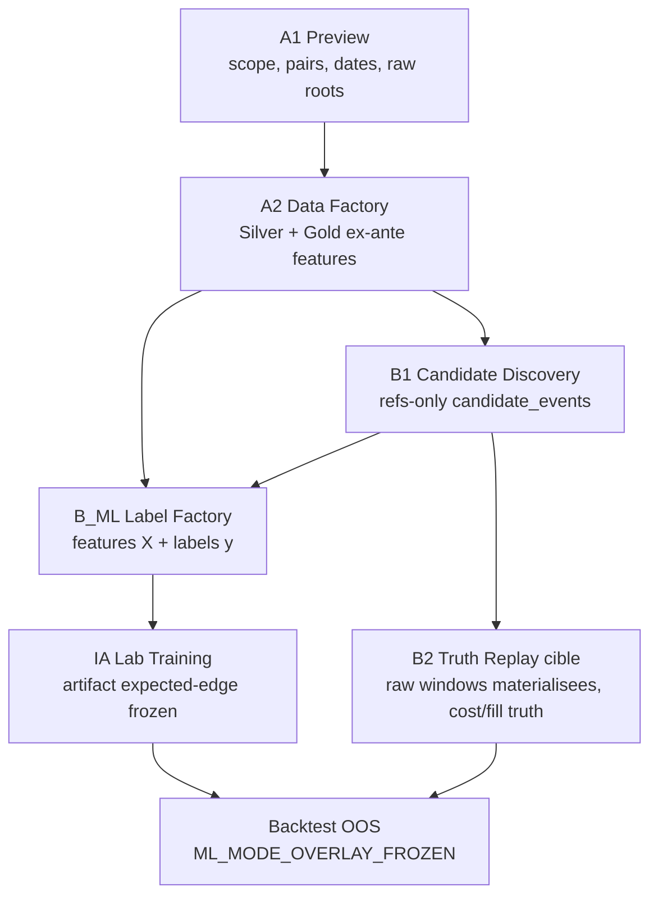

# White Book Operateur FR - Lancement A1 vers Backtest, B_ML et IA Lab

Statut: `A1_BACKTEST_BML_IALAB_OPERATOR_GUIDE_READY`

Date: 2026-05-27

## 1. Objet

Ce document decrit le workflow operateur complet pour lancer V5.3 depuis A1:

```text
A1 Preview
-> A2 Data Factory
-> B1 Candidate Discovery refs-only
-> B2 Truth Replay cible
-> B_ML Training Label Factory
-> IA Lab expected-edge training
-> Backtest OOS avec ML frozen
```

Le but est d'eviter les erreurs de lancement:

- ne pas confondre B1 refs-only avec une verite de trade;
- ne pas lancer IA Lab sur une fenetre qui chevauche le backtest;
- ne pas croire que les features calculees en A2 debloquent automatiquement expected-edge;
- ne pas transformer un proxy de cout/fill/edge en truth;
- ne pas relancer A1/A2 inutilement quand le dataset est deja fige;
- garder les JSONL comme source audit, et utiliser Parquet seulement comme mirror rapide gouverne.

## 2. Doctrine Non Negociable

V5.3 garde ces invariants:

- Engines A/B/C/D inchanges.
- Aucun seuil engine modifie par ce workflow.
- ML = overlay gouverne; il ne cree pas de candidat et ne change pas le side.
- B1 refs-only = discovery/candidate refs, pas execution truth.
- B2 = verite replay ciblee pour cout/fill/slippage/decision reports.
- B_ML = dataset X/y pour training, pas backtest de rentabilite.
- IA Lab = entrainement/export artifact, pas execution.
- Backtest OOS = evaluation avec artifact frozen, pas training silencieux.
- `EXPECTED_EDGE_PROXY_BLOCKED`, `PARTIALLY_MEASURED`, `FILL_REALISM_NOT_PROVEN` restent valides tant qu'ils ne sont pas prouves par artifacts mesures.

## 3. Vue Globale Du Workflow



Regle pratique:

- A1/A2 fabriquent le dataset de marche.
- B1 fabrique le catalogue de candidats.
- B2 prouve la verite execution/cout sur des candidats cibles.
- B_ML fabrique un label store ML.
- IA Lab entraine et fige l'artifact.
- Le backtest final compare `ML_MODE_OFF` vs `ML_MODE_OVERLAY_FROZEN` hors echantillon.

## 4. Inputs Globaux A Renseigner

Depuis `/backtest`:

```text
Orderbook root: L:\ordrebookpart1
Trades root:    L:\trades
Klines root:    L:\klines
Metadata root:  chemin metadata si disponible
Output root:    L:\output backtest
Pairs:          BTCUSDT puis multi-pair si le smoke passe
Timeframes:     commencer simple; ajouter multi-frame ensuite
Start/End:      fenetre exacte du test
Silver storage: jsonl_gz pour runs larges
ML mode A1/A2:  ML_MODE_OFF
```

Regles:

- Les phases d'un meme run doivent garder le meme `workflow_run_id`.
- Ne pas changer pairs/timeframes/dates entre A1, A2, B1, B2 sauf si l'objectif est un nouveau workflow.
- Pour un smoke, utiliser une petite fenetre.
- Pour un diagnostic, utiliser une fenetre book-covered.
- Pour une preuve OOS, le training doit etre avant la fenetre de backtest.

## 5. Phase A1 - Preview / Source Scope Validation

### But

A1 ne materialise pas le dataset. A1 verifie:

- raw roots selectionnes;
- pairs detectees;
- intersection date commune;
- request hash;
- workflow id;
- estimation volume raw/silver/gold;
- launch doctrine.

### Config Recommandee

```text
Phase: A1 Preview / Source Scope Validation
ML mode: ML_MODE_OFF
Pairs: BTCUSDT pour smoke, puis BNBUSDT/BTCUSDT si multi-pair
Timeframes: selection backtest voulue
Output root: L:\output backtest
Intent: Generate Preview
```

### Outputs Attendus

```text
build/cockpit/backtest_jobs/previews/<preview_id>/source_date_preview_manifest.json
workflow_run_id
workflow_request_hash
request_hash
source scope report
```

### Checklist A1

Verifier:

- `Launchable` devient possible pour A2.
- `Detected pair(s)` contient les pairs attendues.
- `Common intersection` couvre la fenetre.
- `Matched files total > 0`.
- Pas de `SOURCE_NOT_SELECTED`.
- Pas de `NO_COMMON_DATA_INTERSECTION`.

### Erreurs Frequentes

| Symptome | Cause probable | Action |
|---|---|---|
| `Detected pair(s)=none` | mauvais root ou pas de preview genere | cliquer Generate Preview et verifier paths |
| `NO_COMMON_DATA_INTERSECTION` | les sources ne couvrent pas les memes jours | corriger dates ou source manquante |
| output root `not_ready` | output root invalide/non writable | choisir un output root hors raw roots |

## 6. Phase A2 - Data Factory Materialization

### But

A2 transforme les raw roots en dataset fige:

```text
raw files
-> silver compressed/indexed
-> gold features ex-ante
-> data quality reports
```

A2 prepare les features disponibles avant decision:

- `close_return`
- `high_low_range`
- `volume`
- `spread_bps` si book disponible/frais
- `book_depth_levels` si depth prouve
- `cumulative_ofi`
- `vpin`
- `queue_pressure` si couverture prouvee
- `realized_vol_current`
- autres features microstructure uniquement si provenance explicite

### Config Recommandee

```text
Phase: A2 Data Factory Materialization
ML mode: ML_MODE_OFF
Silver storage: jsonl_gz
Same workflow_run_id as A1
Same pairs/timeframes/dates as A1
```

### Outputs Attendus

Sous:

```text
<workflow_root>/phase_a2_data_factory/
```

Verifier:

```text
data_factory_manifest.json
silver_index.json
data_quality_report.json
gold/
gold_feature_manifest.json
microstructure_* reports si disponibles
```

### Conditions De Passage

A2 est exploitable pour B1/B2/B_ML si:

```text
data_factory_status = DATA_FACTORY_READY
silver_index_status = SILVER_INDEX_READY
gold_feature_store_status = GOLD_FEATURE_STORE_READY ou FEATURE_STORE_READY
rows_rejected = 0 ou explique
blocker_codes = [] ou research-only accepte
```

### Important

A2 calcule des features X ex-ante. A2 ne cree pas l'expected edge gouverne.  
Donc les blockers `EXPECTED_EDGE_PROXY_BLOCKED` peuvent rester apres A2, meme si les features sont bien calculees.

## 7. Phase B1 - Candidate Discovery Refs-Only

### But

B1 lit le Gold A2 et produit des candidats/references:

```text
A2 gold features
-> native candidate surfaces
-> fast_candidates/candidate_events.jsonl
-> optional candidate_events.parquet mirror
```

B1 ne doit plus materialiser tous les raw windows. C'est la base du gain de temps.

### Config Recommandee

```text
Phase: B1 Candidate Discovery
ML mode: ML_MODE_OFF
Raw window mode: REFS_ONLY via cockpit/runner
Candidate discovery:
  - smoke: TEMPORAL_STRATIFIED ou SAMPLE_CAPPED_DEBUG
  - diagnostic: FULL_DISCOVERY avec full scan explicite si la fenetre est controlee
```

### Outputs Attendus

```text
<workflow_root>/phase_b1_candidate_discovery/backtest_strategy_ladder/<workflow_run_id>/fast_candidates/candidate_events.jsonl
<workflow_root>/phase_b1_candidate_discovery/backtest_strategy_ladder/<workflow_run_id>/fast_candidates/candidate_events.parquet
<workflow_root>/phase_b1_candidate_discovery/backtest_strategy_ladder/<workflow_run_id>/fast_candidates/candidate_events.tabular_manifest.json
<workflow_root>/phase_b1_candidate_discovery/backtest_strategy_ladder/<workflow_run_id>/reports/strategy_ladder_summary.json
```

Si la preselection native existe:

```text
preselection_candidates.jsonl
reports/preselection_summary.json
```

### Conditions De Passage

B1 est bon pour B2 cible si:

```text
candidate_events.jsonl existe
candidate_count > 0
pair/timeframe/engine_id presents
raw_window_materialization_mode = REFS_ONLY
raw_window_extraction_status = RAW_WINDOW_REFS_ONLY
```

### Ce Que B1 Ne Prouve Pas

B1 refs-only ne prouve pas:

- slippage mesure;
- fill ratio;
- adverse selection;
- execution label;
- profitability;
- expected-edge gouverne.

Ces verites appartiennent a B2/B_ML/IA Lab.

## 8. Phase B2 - Truth Replay Cible

### But

B2 part des candidats B1 et materialise seulement les donnees necessaires au replay:

```text
B1 candidate_events ou preselection_candidates
-> raw windows ciblees
-> detailed replay
-> cost/fill/spread/slippage reports
-> decision report
```

### Nouveau Contrat

B2 peut demarrer avec:

```text
fast_candidates/candidate_events.jsonl
```

Si `preselection_candidates.jsonl` est present et ready, il reste prioritaire.  
Si seule la discovery B1 existe, B2 est lance avec l'avertissement:

```text
PHASE_B2_TARGETED_TRUTH_FROM_B1_DISCOVERY_CANDIDATES
```

Ce n'est pas un blocker. C'est un signal que B2 va refaire la verite ciblee depuis les candidats discovery.

### Config Smoke ML_OFF

```text
Phase: B2 Detailed Replay
ML mode: ML_MODE_OFF
Same workflow_run_id
Same pairs/timeframes/dates
Candidate input: B1 candidate_events/preselection
Command must include: --detailed-only --resume --candidate-events-path <...>
Command must NOT include: --raw-window-mode REFS_ONLY
```

### Outputs Attendus

```text
<workflow_root>/phase_b2_detailed_replay/backtest_strategy_ladder/<workflow_run_id>/run_manifest.json
<...>/reports/strategy_ladder_summary.json
<...>/reports/profitability_truth_verdict.json
<...>/reports/backtest_decision_report.json
<...>/reports/backtest_decision_report_final_verdict.json
<...>/reports/measured_spread_report.json
<...>/reports/measured_slippage_report.json
<...>/reports/fill_realism_report.json
<...>/reports/f16_feature_coverage_report.json
<...>/ml_label_store/strategy_ladder_replay_label_store.jsonl si produit
```

### Conditions De Passage

B2 est utile si:

```text
raw_window_extraction_status = RAW_WINDOW_READY ou equivalent
detailed_replay_status explique
candidate_count > 0
blocker_codes lisibles
cost/fill reports existent
decision report existe
```

### Interpretation Des Blockers B2

| Blocker | Sens | Resolution |
|---|---|---|
| `EXPECTED_EDGE_PROXY_BLOCKED` | pas d'expected-edge gouverne | produire artifact IA Lab OOS et relancer frozen |
| `PARTIALLY_MEASURED` | cout/fill/slippage/adverse selection incomplets | verifier book depth, fees, fill realism, adverse selection |
| `STATISTICAL_VALIDATION_INSUFFICIENT_EXECUTIONS` | pas assez de trades executes | elargir periode/pairs apres gouvernance cost/fill |
| `NO_EXECUTED_TRADES` | aucun trade truth execute | auditer native gates/cost/fill, ne pas forcer |
| `FILL_REALISM_NOT_PROVEN` | fill non prouve | verifier orderbook/trades/frais/capital buckets |

## 9. Phase B_ML - Training Label Factory

### But

B_ML fabrique un dataset ML:

```text
A2 gold ex-ante features
-> candidates B_ML
-> post-window labels
-> eligibility audit
-> labels/b_ml_label_store.jsonl
```

B_ML ne repond pas a "V5.3 est rentable".  
B_ML repond a "avons-nous des couples X/y non-leaky pour entrainer le ML ?".

### Inputs B_ML

```text
A2 run root: <workflow_root>/phase_a2_data_factory
B1 candidate events: optional selon sampler mode
Pairs/timeframes: meme scope que le dataset vise
Feature names: selection ex-ante
Label horizons: 5m,15m,1h par defaut
Capital buckets: 400,500,1500,4000 par defaut
```

### Sampler Modes

#### TEMPORAL_STRATIFIED_BACKGROUND_GRID

Meilleur premier lancement.

Utilise:

- A2 gold rows;
- echantillonnage temporel;
- candidats background;
- pas besoin de B1.

Avantage:

- test rapide de couverture X/y;
- bon pour verifier post-windows et leakage.

Limite:

- pas un dataset centre sur les candidats natifs engine.

#### REUSE_B1_FAST_CANDIDATES

A utiliser apres B1 propre.

Utilise:

- `fast_candidates/candidate_events.jsonl`;
- candidate_id/pair/timeframe/engine_id natifs;
- features A2 alignees au timestamp decision.

Avantage:

- labels attaches a la surface native des engines.

#### ENGINE_NATIVE_DRY_EVAL

Mode strict a utiliser seulement si les artifacts natifs existent deja.  
Ne pas utiliser comme premier lancement.

#### ENGINE_NATIVE_DRY_EVAL_AND_BACKGROUND_GRID

Mode avance:

- combine B1/native et background grid;
- utile pour class imbalance et contexte marche;
- plus lourd a auditer.

### Outputs B_ML Attendus

```text
<workflow_root>/phase_b_ml_training_label_factory/labels/b_ml_label_store.jsonl
<...>/labels/b_ml_label_summary.json
<...>/labels/b_ml_target_policy_report.json
<...>/reports/b_ml_training_dataset_audit.json
<...>/reports/b_ml_training_row_eligibility_report.json
<...>/reports/b_ml_feature_label_leakage_report.json
<...>/reports/b_ml_final_verdict.json
<...>/reports/b_ml_tabular_artifact_index.json
```

Mirrors rapides si disponibles:

```text
labels/b_ml_label_store.parquet
candidates/b_ml_candidate_events.parquet
features/b_ml_feature_matrix.parquet
windows/raw_window_index.parquet
windows/post_window_index.parquet
```

### Conditions De Passage Pour Training

Verifier:

```text
training_row_eligible_count > 0
feature_leakage_count = 0
target_policy_mismatch_count = 0
train_eval_overlap_blocked = false
final_verdict in {BML_READY_GOVERNED, BML_READY_RESEARCH}
```

Si le verdict est `B_ML_DATASET_RESEARCH_ONLY_COST_PARTIAL`, le dataset peut servir a l'audit/research, mais pas a une promotion expected-edge production.

## 10. IA Lab - Training Expected-Edge

### But

IA Lab entraine un artifact expected-edge a partir d'un dataset autorise:

```text
features X ex-ante
labels y post-decision
train/validation split non-overlap
artifact hash
feature hash
handoff report
```

### Deux Rails

#### Rail UI Cockpit `/lab`

Champs principaux:

```text
kline_root
b2_run_root si features non-legacy / replay
pair
timeframe
train_start
train_end
feature_names
```

Utiliser ce rail si:

- tu veux rester dans le cockpit;
- tu as un B2 run root pour features non-legacy;
- tu veux produire un handoff standard pour Backtest.

Limite actuelle:

- le champ direct `label_store_dataset_path` B_ML n'est pas encore expose dans l'UI IA Lab standard.

#### Rail CLI direct B_ML

Utiliser ce rail si tu veux entrainer exactement sur:

```text
labels/b_ml_label_store.jsonl
```

Script:

```text
scripts/train_strategy_ladder_expected_edge_artifact.py
```

Parametre cle:

```text
--label-store-dataset-path <...>/labels/b_ml_label_store.jsonl
```

### Outputs IA Lab Attendus

Dans le run IA Lab:

```text
strategy_ladder_ml_lab_handoff_report.json
strategy_ladder_backtest_ml_input.json
strategy_ladder_expected_edge_ml_model_bundle.summary.json
feature_grounding_contract_report.json
training_source_contract_report.json
ml_overlay_authority_contract_report.json
ml_train_eval_overlap_report.json
```

### Conditions Pour Artifact Frozen Utilisable

```text
handoff ready = true
artifact hash present
feature_names matchent le backtest
target policy coherent
train_end < validation_start
validation_end < backtest_start
no train/eval overlap
labels non-leaky
```

### Important

Un artifact IA Lab ne doit jamais etre entraine sur la meme fenetre que le backtest d'evaluation.

## 11. Backtest OOS Avec ML Frozen

### But

Comparer le comportement natif et le comportement ML overlay sur la meme fenetre OOS.

### Procedure

1. Lancer un B2 `ML_MODE_OFF` sur la fenetre OOS.
2. Lancer IA Lab sur une fenetre anterieure sans overlap.
3. Recuperer `strategy_ladder_backtest_ml_input.json` et artifact hash.
4. Relancer B2 sur la fenetre OOS avec:

```text
ML_MODE_OVERLAY_FROZEN
frozen_ml_artifact_path
frozen_ml_artifact_hash
expected_edge_artifact_mode
rolling_ml_window_plan_path si utilise
```

### Comparaison A Faire

Comparer:

- candidate_count;
- selected_count;
- executed_count;
- hard_blocked_count;
- reason_code delta;
- expected_edge delta;
- spread/slippage/cost;
- fill realism;
- profitability verdict;
- ML benefit status.

### Regle De Verdict

```text
executed_count < 50   -> inconclusive
50 <= executed < 100 -> diagnostic fragile
executed >= 100 + zero proxy -> verdict exploitable
```

Si `executed_count=0` apres ML frozen:

- ne pas forcer de trade;
- auditer native gates;
- auditer cost/fill;
- auditer expected-edge artifact;
- verifier que ML overlay ne cree pas de candidat par design.

## 12. Configs Recommandees

### Smoke Engineering 1 Jour

```text
Pair: BTCUSDT
Dates: 1 jour book-covered
Timeframes: 1m ou 15m selon cout
Silver: jsonl_gz
A1 -> A2 -> B1 refs-only -> B2 ML_OFF
B_ML: TEMPORAL_STRATIFIED_BACKGROUND_GRID
IA Lab: seulement si B_ML/B2 donne rows eligibles
```

Objectif:

- verifier que le pipeline lance;
- verifier que B2 n'est plus bloque par preselection manquante;
- verifier que les rapports existent;
- verifier que les blockers sont explicites.

### Diagnostic 2 Mois

```text
Training IA Lab: fenetre anterieure book-covered
Validation: apres train, avant OOS
Backtest OOS: 2 mois book-covered
Pairs: commencer BTCUSDT, puis multi-pair
Timeframes: selection Backtest multi-frame
```

Objectif:

- assez de candidats;
- assez de labels;
- zero overlap;
- evaluation OOS.

### Institutionnel 6 Mois

Split recommande:

```text
Train:      3 mois
Validation: 1 mois
OOS test:   2 mois
```

Walk-forward:

```text
train 90 jours
validation 30 jours
test 30 jours
roll 30 jours
embargo/purge entre fenetres
```

## 13. Checklist Avant Launch

Avant A2:

- paths raw corrects;
- preview A1 launchable;
- pairs detectees;
- dates communes;
- output root writable.

Avant B1:

- `data_factory_manifest.json` ready;
- `silver_index.json` ready;
- `gold/` existe;
- same workflow id.

Avant B2:

- `candidate_events.jsonl` existe;
- A2 silver/gold existent;
- B2 command contient `--candidate-events-path`;
- B2 command ne contient pas `--raw-window-mode REFS_ONLY`;
- comprendre si preselection native existe ou non.

Avant B_ML:

- A2 ready;
- sampler mode choisi consciemment;
- si `REUSE_B1_FAST_CANDIDATES`, B1 candidate file existe;
- features selectionnees sont ex-ante;
- label horizons compatibles avec la fenetre.

Avant IA Lab:

- dataset training existe;
- feature list stable;
- pas de leakage;
- fenetre train/validation avant backtest OOS;
- artifact hash sera conserve.

Avant Backtest Frozen:

- artifact path et hash presents;
- feature mismatch absent;
- no train/eval overlap;
- B2 OOS scope fige;
- ML ne doit pas creer de candidats.

## 14. Lecture Rapide Des Outputs

### A2

Lire:

```text
data_factory_manifest.json
silver_index.json
gold_feature_manifest.json
data_quality_report.json
```

Bon signe:

```text
DATA_FACTORY_READY
SILVER_INDEX_READY
FEATURE_STORE_READY
rows_rejected=0
```

### B1

Lire:

```text
fast_candidates/candidate_events.jsonl
fast_candidates/candidate_events.tabular_manifest.json
reports/strategy_ladder_summary.json
```

Bon signe:

```text
candidate_count > 0
raw_window_materialization_mode=REFS_ONLY
```

### B2

Lire:

```text
reports/strategy_ladder_summary.json
reports/profitability_truth_verdict.json
reports/backtest_decision_report_final_verdict.json
```

Bon signe:

```text
blockers explicites
cost/fill reports presents
no silent proxy promotion
```

### B_ML

Lire:

```text
reports/b_ml_training_dataset_audit.json
reports/b_ml_training_row_eligibility_report.json
reports/b_ml_final_verdict.json
labels/b_ml_label_store.jsonl
```

Bon signe:

```text
training_row_eligible_count > 0
feature_leakage_count=0
target_policy_mismatch_count=0
```

### IA Lab

Lire:

```text
strategy_ladder_ml_lab_handoff_report.json
strategy_ladder_backtest_ml_input.json
strategy_ladder_expected_edge_ml_model_bundle.summary.json
```

Bon signe:

```text
ready=true
artifact_hash present
feature_names stables
train/eval overlap blocked=false
```

## 15. Pourquoi Les Features Ne Suffisent Pas A Debloquer Expected Edge

Les features A2/B_ML sont les inputs X:

```text
close_return, volume, spread, depth, OFI, VPIN, queue_pressure, realized_vol...
```

Expected edge gouverne exige aussi un y fiable:

```text
forward outcome
cost-adjusted return
fill ratio
slippage measured
adverse selection measured
target policy coherent
no leakage
OOS validation
```

Donc le pipeline peut avoir des features calculees et rester bloque par:

```text
EXPECTED_EDGE_PROXY_BLOCKED
PARTIALLY_MEASURED
FILL_REALISM_NOT_PROVEN
STATISTICAL_VALIDATION_INSUFFICIENT_EXECUTIONS
```

Ce n'est pas contradictoire. C'est la difference entre "features disponibles" et "preuve economique gouvernee".

## 16. Commandes De Verification Dev

Compilation:

```powershell
python -X pycache_prefix=tmp_pycache_b2_truth -m compileall -q src tests
```

Tests cockpit utiles:

```powershell
python -m pytest tests/cockpit/test_cockpit_server_routes.py -q -k "phase_launches_use_phase_specific_consumed_artifact_refs or phase_b1_command_uses_refs_only_raw_window_mode or phase_b2_command_keeps_materialized_raw_window_mode" --tb=short
python -m pytest tests/cockpit/test_b_ml_dataset_factory_ui.py tests/cockpit/test_backtest_feature_picker_chain.py tests/cockpit/test_backtest_multipair_form_state.py -q --tb=short
```

Tests runner utiles:

```powershell
python -m pytest tests/test_local_replay_runtime/test_strategy_ladder_runner.py -q -k "strategy_ladder_runner_hydrates_b2_from_consumed_a2_and_b1_artifacts or b2_detailed_replay_keeps_raw_window_materialization_by_default" --tb=short
```

## 17. Decision Tree Operateur

```text
Tu veux verifier les donnees raw?
-> A1

Tu veux fabriquer dataset marche?
-> A2

Tu veux lister les candidats natifs vite?
-> B1 refs-only

Tu veux savoir pourquoi les trades passent/ne passent pas?
-> B2 ML_OFF truth replay

Tu veux fabriquer un dataset ML X/y?
-> B_ML

Tu veux entrainer expected-edge?
-> IA Lab ou CLI label_store

Tu veux evaluer le ML sans leakage?
-> B2 OOS avec ML_MODE_OVERLAY_FROZEN
```

## 18. Conclusion

Le nouveau workflow cible est:

```text
A1 pour verifier
A2 pour figer
B1 pour trouver vite
B2 pour prouver
B_ML pour labelliser
IA Lab pour entrainer
B2 OOS frozen pour juger
```

Tant que expected-edge, cost/fill, labels et statistiques ne sont pas gouvernes, le verdict correct reste `research-only` ou `inconclusive`, meme si toutes les features ex-ante sont calculees.
