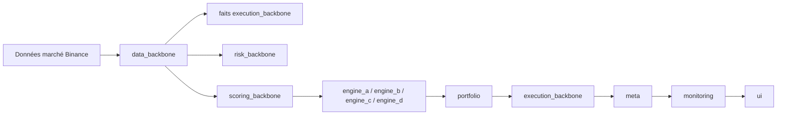
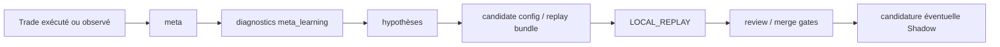
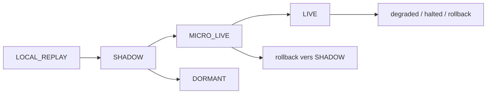

# V5.3 WHITE BOOK - PARTIE 1
## Doctrine, architecture, logique de rollout et état actuel des builds

---

# 0. Résumé exécutif

V5.3 est une architecture de trading crypto spot halal, CPU-only, conçue pour résoudre un problème très précis :

> un système peut être mathématiquement élégant et rester économiquement stérile.

L’objectif n’est donc ni “l’intelligence maximale”, ni “le maximum de trades”.

L’objectif est :

- plus de fréquence utile
- une capital efficiency crédible
- des budgets de risque explicites
- aucune fourche d’architecture cachée
- aucune mutation live silencieuse
- une auditabilité complète

V5.3 n’est pas construite autour d’un seul gros modèle.  
Elle est construite autour d’une séparation stricte des responsabilités :

- intégrité de la donnée
- vérité d’exécution
- budgets de risque
- différenciation des signaux
- arbitrage portefeuille
- diagnostic post-trade
- gouvernance de rollout
- safing opérateur

---

# 1. Philosophie fondamentale

## 1.1 Problème à résoudre

Le problème canonique que V5.3 cherche à résoudre est le suivant :

- capital petit à modéré
- spot only
- pas de levier
- coûts réels
- bruit réel d’exchange
- faible tolérance au risque caché
- historique d’over-filtering et de sous-trading

Le système doit donc améliorer la monétisabilité sans tomber dans :

- le relâchement gratuit des seuils
- le faux alpha purement backtest
- la sophistication microstructure surfitée
- la mutation live pilotée par IA
- le chaos de plugins et variantes concurrentes

## 1.2 Philosophie non négociable

V5.3 rejette explicitement :

- le levier
- les futures / perpetuals
- les seconds profils cachés
- les forks locaux de stratégie
- la mutation live autonome par IA
- le bypass de Shadow -> Micro-live -> Live

V5.3 privilégie explicitement :

- une seule base de code
- deux profils métier seulement : `LIGHT`, `COMPLETE`
- quatre `runtime_mode` seulement : `LOCAL_REPLAY`, `SHADOW`, `MICRO_LIVE`, `LIVE`
- des contrats typés
- des logs structurés
- une persistance atomique
- des dégradations visibles côté opérateur
- une promotion seulement après preuve temps réel

---

# 2. Hard states et doctrine de promotion

## 2.1 Hard states

Le système utilise un vocabulaire strict d’état de vie :

| Hard state | Signification |
| --- | --- |
| `CODED` | le code existe |
| `DOCUMENTED` | la spec canonique existe |
| `SHADOW_ENABLED` | pleinement actif en Shadow |
| `SHADOW_VALIDATED` | Shadow 30 jours terminé avec verdict positif |
| `MICRO_LIVE_ELIGIBLE` | peut entrer en Build-12 |
| `LIVE_LIGHT_ELIGIBLE` | peut entrer en Build-13 |
| `COMPLETE_ELIGIBLE` | peut entrer dans la trajectoire Complete après preuve |
| `PROMOTED` | activé dans le périmètre live autorisé |
| `DORMANT` | présent mais volontairement non promu |
| `FORBIDDEN` | explicitement interdit en V5.3 |

La règle anti-hallucination la plus importante est :

- `CODED` ne signifie pas `VALIDATED`
- `SHADOW_ENABLED` ne signifie pas `PROMOTED`
- `PROMOTED` ne découle jamais automatiquement de l’existence du code

## 2.2 Doctrine temporelle de promotion

La logique canonique de rollout est temporelle, pas rhétorique.

Sur la doctrine active de cette branche :

1. Build-11 : `LIGHT + SHADOW`
2. Build-12 : `LIGHT + MICRO_LIVE`
3. Build-13 : `LIGHT + LIVE`
4. puis extensions Complete après preuve supplémentaire

Nuance propre à cette branche :

- la branche de migration traite le périmètre initial de Shadow comme `A/B/C/D + Build-14` observés en Shadow
- mais cela n’implique pas une promotion live automatique de C/D

## 2.3 Gates temporels qui comptent

Règles dures visibles dans les specs et les audits :

- Build-11 exige `30` jours calendaires consécutifs en Shadow
- une interruption de plus de `24h` remet le compteur à zéro
- Build-13 exige au moins `7` jours de stabilité en Build-12
- Build-12 et Build-13 ne peuvent pas se fermer honnêtement tant que Build-11 n’est pas runtime-complet

---

# 3. Profils, runtime modes et univers de paires

## 3.1 Profils

| Profil | Signification |
| --- | --- |
| `LIGHT` | rollout initial borné |
| `COMPLETE` | enveloppe de rollout étendue |

## 3.2 Runtime modes

| Runtime mode | Signification |
| --- | --- |
| `LOCAL_REPLAY` | replay gouverné offline de la même V5.3 |
| `SHADOW` | données marché live, sans ordres réels |
| `MICRO_LIVE` | petite exécution réelle |
| `LIVE` | exécution réelle en production |

## 3.3 Paires canoniques

Set `LIGHT` :

- BTCUSDT
- ETHUSDT
- BNBUSDT
- SOLUSDT
- XRPUSDT
- LINKUSDT

Set `COMPLETE` additionnel :

- ADAUSDT
- AVAXUSDT
- DOTUSDT
- MATICUSDT
- ATOMUSDT
- NEARUSDT

## 3.4 Logique moteurs -> paires

- `engine_a` : sous-ensemble LIGHT curé
- `engine_b` : sous-ensemble LIGHT curé
- `engine_c` : toutes les paires canoniques
- `engine_d` : toutes les paires canoniques

Interprétation :

- A/B sont le noyau de monétisation initial
- C/D sont des moteurs d’extension et de diversification
- Complete n’invente aucun moteur hors A/B/C/D

---

# 4. Carte d’architecture

## 4.1 Structure build par build

| Build | Périmètre | Ce qu’il verrouille |
| --- | --- | --- |
| 1 | architecture | contrats, manifest, DAG, contract tests, bootstrap/recovery |
| 2 | data | ingestion websocket, normalisation, fraîcheur, cohérence, pair health |
| 3 | execution | état ordre, coût réel, réconciliation |
| 4 | risk | exposition, budget perte, clusters, facteur BTC, kill persistence |
| 5 | scoring | hard blockers, soft penalties, ranking |
| 6 | engine A | premium trend / expansion |
| 7 | engine B | mean reversion intraday |
| 8 | portfolio | arbitrage d’opportunités sous budgets |
| 9 | meta | DTR, CRA, break-even, edge tracking prudent |
| 9x | learning gouverné | diagnostic post-trade, hypothèses, replay bundles, review gates |
| 10 | monitoring/UI | surfaces de supervision, alertes, control plane |
| 11 | Shadow | preuve réelle sans ordres réels |
| 12 | Micro-live | exécution réelle sous petit budget |
| 13 | Live-Light | rollout live borné |
| 14 | enablers | readers enrichis non autonomes |
| 15 | engine C | breakout continuation |
| 16 | engine D | re-entry / second chance |
| 17 | UI/live Complete | supervision et runtime Complete |

## 4.2 Inventaire canonique des modules

Le manifest courant expose ces modules canoniques :

- `interface_contracts`
- `manifest_registry`
- `dag_validator`
- `contract_test_suite`
- `smoke_bootstrap_recovery`
- `data_backbone`
- `execution_backbone`
- `risk_backbone`
- `scoring_backbone`
- `engine_a`
- `engine_b`
- `portfolio`
- `meta`
- `local_replay_runtime`
- `backtest_artifact_import`
- `meta_learning`
- `monitoring`
- `ui`
- `protocols`
- `complete_enablers`
- `engine_c`
- `engine_d`

Un des grands points forts de V5.3 est ici :

- l’architecture est assez explicite pour être auditée
- la nomenclature de modules est assez stable pour qu’on puisse discuter responsabilité sans ambiguïté

---

# 5. Flux de données bout en bout

## 5.1 Flux primaire de trading

Interprétation :

- la donnée ne va jamais directement de l’exchange vers le moteur puis l’ordre
- elle passe par l’intégrité data, le scoring, le risque et l’arbitrage portefeuille
- la vérité d’exécution revient ensuite dans `meta` et `monitoring`

## 5.2 Flux de learning gouverné

Point essentiel :

- Build-9X est une couche de learning
- il n’a pas le droit de muter le live directement

## 5.3 Flux de rollout

---

# 6. Architecture orientée protection

V5.3 se protège à plusieurs niveaux.

## 6.1 Protection structurelle

- validation DAG
- manifest registry
- contract tests
- smoke tests bootstrap/recovery

## 6.2 Protection data

- rejet crossed-book
- logique de latence monotone
- stale guard
- suspension paire par paire
- visibilité backlog/queues

## 6.3 Protection exécution

- tracking du coût réel
- réconciliation
- gestion timeout ordre
- pas de divergence silencieuse compte / état local

## 6.4 Protection risque

- caps d’exposition
- budget perte
- budget beta
- budget cluster
- prudence liée au drawdown
- kill switch persistant

## 6.5 Protection gouvernance

- review gates
- interdiction du live mutation path
- IDs structurés et audit trail
- intégrité de profil
- interdiction de fork local/live

## 6.6 Protection opérateur

- `set_halted` manuel
- downgrade manuel vers `MICRO_LIVE`
- downgrade manuel vers `SHADOW`
- états explicites `DEGRADED` et `HALTED`

---

# 7. Lecture de l’état actuel de la branche

## 7.1 Ce qui est relativement gelé

Sur cette branche, les éléments suivants sont raisonnablement gelés :

- Build-1
- Build-2
- Build-3
- Build-5
- Build-6
- Build-7
- Build-8
- Build-9
- Build-9x
- Build-10
- Build-14

## 7.2 Ce qui est ouvert mais techniquement significatif

- Build-15 : codé, mais pas encore closure-complete
- Build-16 : codé, mais pas encore closure-complete

## 7.3 Ce qui reste structurellement bloqué

- Build-11 : nécessite encore la vraie preuve Shadow 30 jours
- Build-12 : bloqué par Build-11
- Build-13 : bloqué par Build-11 et Build-12
- Build-17 : surface UI/runtime encore incomplète

## 7.4 Vérité pratique

L’architecture est aujourd’hui beaucoup plus mûre qu’un prototype.

Mais le système n’est pas autorisé à prétendre :

- fermeture complète du rollout
- validation Micro-live
- validation Live-Light
- validation Live-Complete

Cette honnêteté est une force, pas une faiblesse.

---

# 8. Forces globales

Les choix de design les plus solides de V5.3 sont :

1. séparation stricte entre signal, risque, portefeuille, exécution et gouvernance
2. refus explicite de la mutation live
3. forte emphase sur coût, CE et santé infra
4. auditabilité build par build
5. contrats typés et inventaire explicite des modules
6. chemin de dégradation visible côté opérateur
7. Shadow traité comme protocole de vérité, pas comme étape cosmétique

---

# 9. Faiblesses et angles morts globaux

## 9.1 Traits négatifs

- le poids doctrinal est élevé : beaucoup de gates, beaucoup de docs, beaucoup d’états
- la fermeture demande du temps, pas seulement du code
- l’architecture peut paraître “finie” avant que la vérité runtime n’existe
- Build-14 peut dériver vers l’inflation de features si la discipline baisse

## 9.2 Angles morts

- l’état de branche peut dériver plus vite que la doctrine si les audits ne sont pas figés fréquemment
- une supervision riche peut encore masquer des métriques placeholder si elles ne sont pas honnêtement branchées
- C/D peuvent exister en code avant que leur standard de fermeture soit réellement gelé
- Build-11 reste vulnérable à des blocages infra/connectivité réels indépendants de la qualité du code

## 9.3 Conclusion de la partie 1

V5.3 se comprend mieux comme :

- un système d’exploitation de trading gouverné
- pas comme une simple stratégie
- pas comme une stack IA-first
- pas comme un jouet piloté par backtests

Sa promesse centrale n’est pas l’agression maximale.  
Sa promesse centrale est une monétisabilité bornée sous discipline de preuve.

